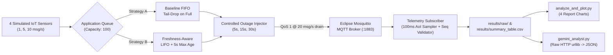
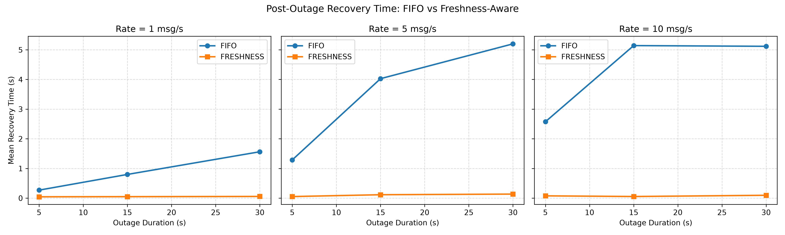
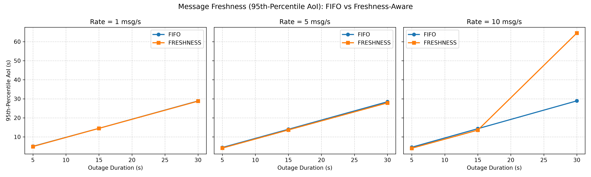
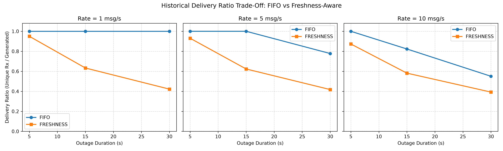
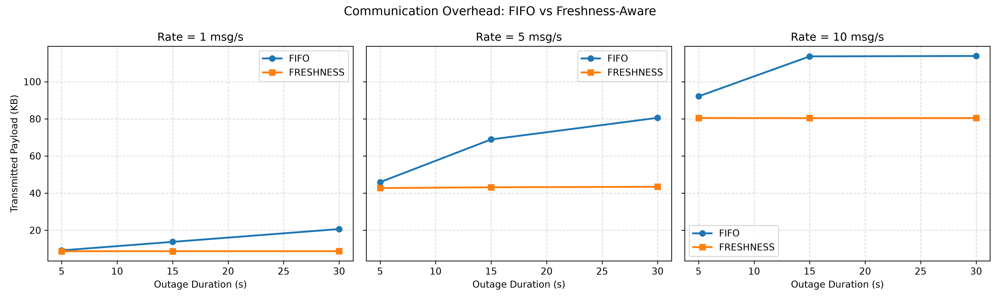

<div align="center">


### 📡 Solving Head-of-Line Blocking in Intermittent IoT Networks

**90-Run Empirical Benchmark | Eclipse Mosquitto (QoS 1) | Zero-AI-Library Gemini REST Analyzer**

[](https://www.python.org/)
[](https://mosquitto.org/)
[](https://ai.google.dev/)
[](https://github.com/Iamaditya9/freshness-iot-mqtt/stargazers)
[](https://github.com/Iamaditya9/freshness-iot-mqtt/issues)

</div>

---

## 📖 About The Project

IoT sensor fleets frequently operate over unstable networks with temporary disconnections. When connectivity returns, conventional **First-In, First-Out (FIFO)** queues drain stale backlog before transmitting current sensor readings—delaying live situational awareness.

**Freshness-Aware IoT MQTT** is a deterministic, reproducible networking testbed that benchmarks a **Baseline FIFO Queue** against a **Bounded Freshness-Aware Queue** (LIFO priority + 5-second staleness eviction) across **90 controlled experiments** (3 outage durations × 3 publish rates × 2 strategies × 5 repetitions).

---

## 🎯 Key Empirical Results (90 Runs)

| Metric | FIFO Baseline | Freshness-Aware | Impact |
| :--- | :---: | :---: | :--- |
| **Post-Outage Recovery** *(15s, 10 Hz)* | `5.1414 s` | **`0.0549 s`** | **~93× Faster** live state recovery |
| **Median Age of Information (AoI)** *(15s, 10 Hz)* | `4.8111 s` | **`0.4814 s`** | **90% Reduction** in staleness |
| **Median End-to-End Delay** *(30s, 5 Hz)* | `17.0496 s` | **`0.0084 s`** | **Flat ~8 ms** latency across all tests |
| **Communication Overhead** *(30s, 5 Hz)* | `82.5 KB` | **`44.5 KB`** | **29%–58% Bandwidth Saved** on reconnect |
| **Delivery Ratio Trade-Off** *(30s, 10 Hz)* | `55.04%` | `39.26%` | Intentional eviction of stale packets |

> **Honest Regression Note:** Under extreme saturation (`30s outage, 10 Hz`), Freshness-Aware exhibited a **95th-percentile AoI spike (`64.53 s` vs. `28.92 s` FIFO)** caused by concurrent overflow and staleness eviction—highlighting the need for hybrid age-capped backoff under heavy congestion.

---

## 🏗️ System Architecture



---

## 📊 Visualized Benchmarks

<details open>
<summary><b>📈 Click to expand/collapse all 4 experimental plots</b></summary>
<br>

| Post-Outage Recovery Time | 95th-Percentile Age of Information (AoI) |
| :---: | :---: |
|  |  |

| Historical Delivery Ratio Trade-Off | Communication Overhead (Transmitted KB) |
| :---: | :---: |
|  |  |

</details>

---

## 🧩 Interactive Project Explorer

<details>
<summary><b>📂 Repository Structure</b></summary>

```text
freshness-iot-mqtt/
├── docker-compose.yml          # Optional Docker setup for Mosquitto
├── mosquitto/
│   └── mosquitto.conf          # Local anonymous listener on port 1883
├── requirements.txt            # paho-mqtt, pandas, matplotlib (Zero AI SDKs)
├── src/
│   ├── config.py               # Experiment matrix & queue parameters
│   ├── queues.py               # FIFOQueue & FreshnessAwareQueue with drop counters
│   ├── publisher.py            # Sensor fleet simulator + outage injector
│   ├── subscriber.py           # Sequence validator, AoI sampler & recovery tracker
│   ├── run_experiments.py      # Automated 90-run benchmark runner (--pilot supported)
│   ├── analyze_and_plot.py     # Summary table aggregator & 300-DPI chart generator
│   └── gemini_analyst.py       # Zero-library raw HTTP (urllib) Gemini JSON analyst
└── results/
    ├── raw/                    # Raw per-run CSV logs
    ├── plots/                  # Publication-ready PNG figures
    ├── summary_table.csv       # 18-condition aggregated metrics
    └── gemini_findings.json    # Structured trade-off audit
```

</details>

<details>
<summary><b>⚡ Quick Start & Reproducibility Guide</b></summary>

### 1. Clone & Set Up Environment
```powershell
git clone https://github.com/Iamaditya9/freshness-iot-mqtt.git
cd freshness-iot-mqtt
python -m venv .venv
.\.venv\Scripts\Activate.ps1
pip install -r requirements.txt
```

### 2. Start Eclipse Mosquitto Broker
**Option A (Docker):**
```powershell
docker compose up -d
```
**Option B (Native Windows):**
```powershell
& "C:\Program Files\mosquitto\mosquitto.exe" -c .\mosquitto\mosquitto.conf -v
```

### 3. Run Experiments & Generate Plots
```powershell
# Quick 2-run pilot (~15 seconds)
python src/run_experiments.py --pilot

# Full 90-run benchmark (~45 minutes)
python src/run_experiments.py

# Generate summary table & 4 PNG charts
python src/analyze_and_plot.py
```

### 4. Run Zero-Library Gemini Post-Analysis (Optional)
```powershell
$env:GEMINI_API_KEY="YOUR_GOOGLE_AI_STUDIO_KEY"
python src/gemini_analyst.py
```

</details>

<details>
<summary><b>🛠️ Operating Recommendations (When to Use Which Queue)</b></summary>

* **Use Freshness-Aware Queuing** for live state-oriented telemetry (digital twins, HVAC, robotics, fleet tracking) where sub-100ms post-outage convergence matters more than historical completeness.
* **Use FIFO Queuing** for audit trails, billing, or security event logs where dropping 40–60% of historical packets during outages is unacceptable.

</details>

---

## 👨‍💻 Author & Contact

**Aditya Yadav**  
*Computer Science — Acadia University*

[](https://github.com/Iamaditya9)
[](mailto:ydaditya39@gmail.com)
[](https://www.linkedin.com/in/aditya-yadav-tech)